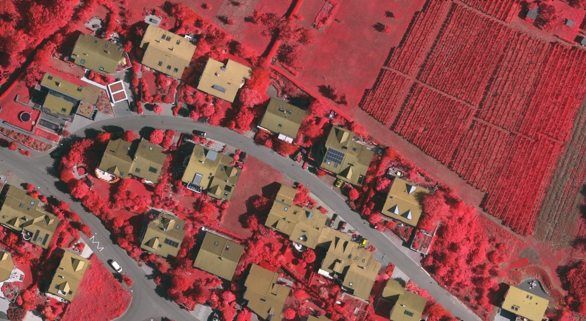
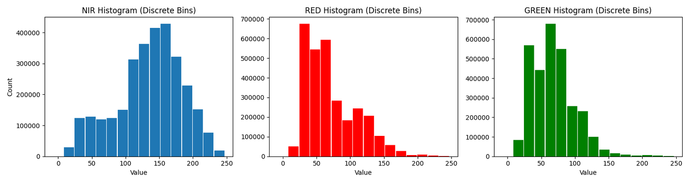
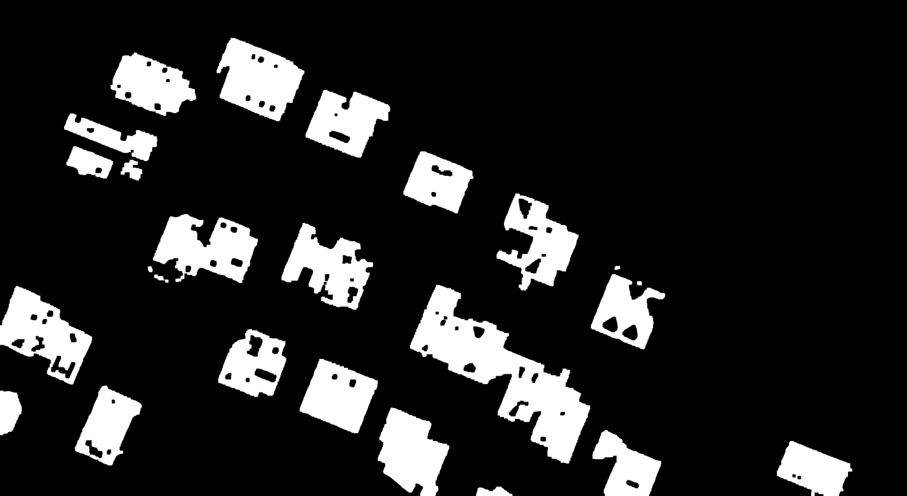
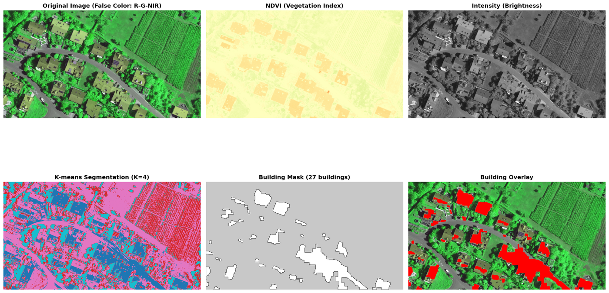
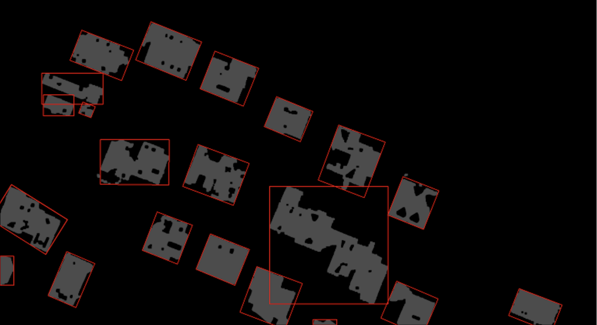
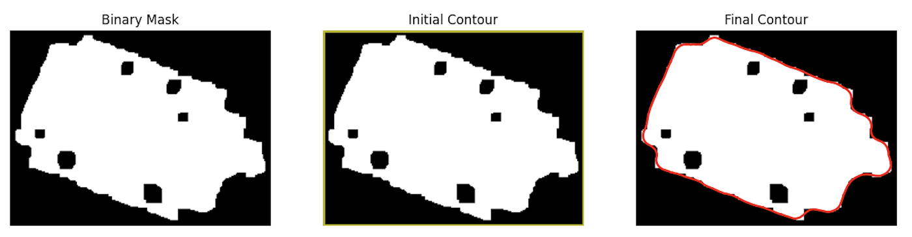
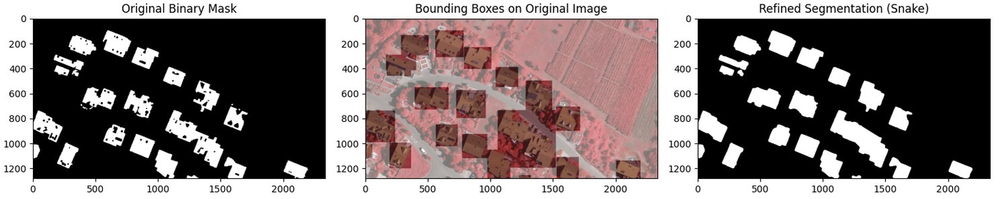
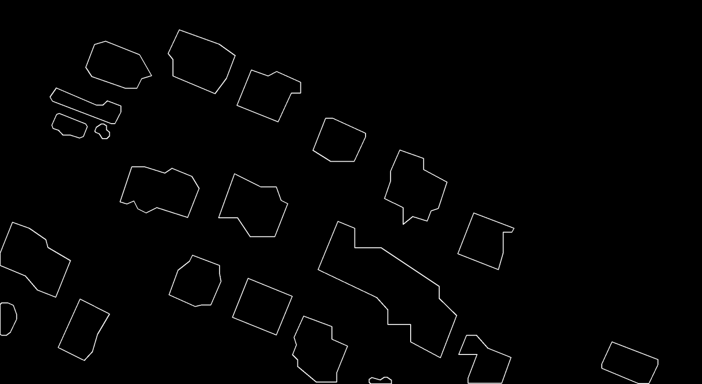
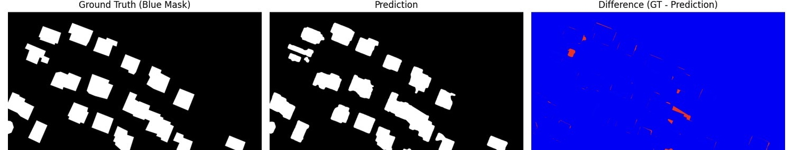
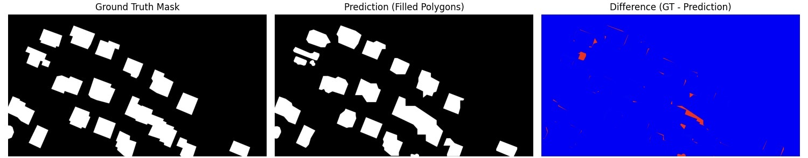

# Finding Buildings in Drone Images Without Machine Learning

Can you outline every building in an aerial photo using only classical image processing: colour analysis, morphology and energy-minimising contours, with no neural network and no training data? This project builds such a pipeline for UAV imagery and measures it against hand-labelled ground truth. It reaches an **IoU of 0.88**.

## The input

A high-resolution drone mosaic with three spectral bands: **near-infrared, red and green**. Although the file looks like an ordinary RGB picture, the channels are really NIR, red and green, which is why vegetation shows up red below. Buildings, with their tiles and metal roofs, look quite different from the vegetation around them, and the pipeline exploits that.

## The pipeline, step by step

### Step 1: Which pixels look like a building?

The first question is which channels separate buildings from the background. Histograms of the three bands (16 bins each) show how their intensities are distributed:

Buildings combine a moderately strong **red reflectance** with a clear **gap between red and green**, whereas vegetation and soil have similar red and green values. This gives two simple rules:

1. the normalised red value must exceed **0.15**, and
2. red must exceed green by at least **15 intensity levels**.

Pixels satisfying both rules form the first binary mask:

The mask has speckle noise and small holes in roofs. A morphological **opening** (7 × 7 kernel) removes isolated pixels and a **closing** with the same kernel fills the gaps:

**Why not clustering?** K-means and mean-shift were tried as alternatives. They separate the main land-cover classes, but they use only spectral similarity and know nothing about shape or neighbourhood. In the experiment below (K = 4) they either fragment buildings or merge them with roads and parking areas, so the simple, interpretable thresholds produced the cleanest and most stable mask.

### Step 2: Cleaning up each building

The threshold mask captures where buildings are, but their outlines are irregular and some buildings are fused together. Refinement works one building at a time.

**Connected components.** The mask is split into separate regions using 8-connectivity, so that diagonal pixels belong to the same roof. Regions smaller than 100 pixels are discarded as noise, and each region gets a bounding box:

**Why bounding boxes?** Each building is processed only inside its own box. That prevents the next stage from drifting onto a neighbouring roof, stops edges from vegetation and roads from interfering, and is faster than working on the whole scene. Boxes that are too thin, too tall, extremely large (several buildings or a parking lot) or close to the image border are rejected.

**Active contours ("snakes").** A closed curve is started around the border of the box and shrinks inwards. It minimises an energy with three terms:

- **elasticity** (do not stretch),
- **bending** (stay smooth),
- **edge attraction** (be pulled towards strong image gradients).

The curve therefore contracts until it snaps onto the roof boundary. It is evolved for 1,500 to 2,500 iterations.

All refined outlines are placed back into a full-size mask:

### Step 3: From pixels to polygons

Buildings are man-made: straight edges, right angles, simple polygons. A pixel mask ignores all of that, so the last stage imposes it:

1. extract the contours,
2. simplify them with the **Douglas-Peucker** algorithm,
3. **snap** each edge to 0°, 90° or 180° when it is within ±15° of it,
4. drop polygons below a minimum area.

The result looks like a GIS building-footprint map:

## Results

Both outputs are scored with **Intersection over Union** against the ground truth (buildings are the pure-blue pixels of the label map; masks are aligned with nearest-neighbour interpolation so the comparison is pixel-exact).

| Output | IoU |
|---|---|
| Refined mask (after active contours) | **0.8814** |
| Final vector polygons | **0.8676** |
| Target | > 0.79 |

In the figures, the left panel is the ground truth, the middle one the prediction and the right one the difference (red = errors). The errors are thin slivers along some edges and a few small buildings.

The refined mask follows complex roof shapes more closely and scores slightly higher. Vectorisation costs about 0.014 IoU, a small price for geometrically regular polygons that are far more useful in a map.

## What you can take from this

- Choosing the right *spectral* feature (red versus green contrast) mattered more than any sophisticated algorithm.
- Each stage repairs a weakness of the previous one: thresholds find candidates, morphology removes noise, active contours sharpen boundaries and vectorisation regularises shape.
- A classical pipeline can be accurate, fast and interpretable, and it needs no labelled training data, which is valuable when labels are expensive.
- Clustering looks attractive but ignores shape, which is exactly what defines a building.

## Files

- `01_segmentation.py`: spectral thresholds and morphology
- `02_refinement.py`: connected components and active contours
- `03_vectorization.py`: contour simplification and angle snapping
- `intersection_over_union_refined_mask.py`, `intersection_over_union_vectorized.py`: IoU evaluation
- `data.zip`: the image data; `assets/`: figures used above
